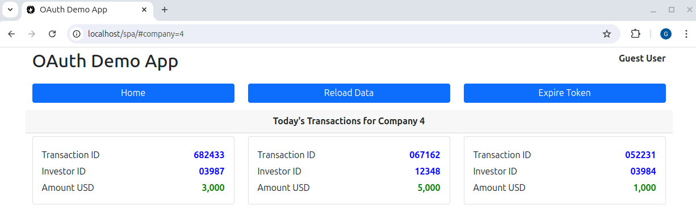

# Initial OAuth SPA and API Code Sample

[](https://app.codacy.com/gh/gary-archer/oauth.websample1?utm_source=github.com&utm_medium=referral&utm_content=gary-archer/oauth.websample1&utm_campaign=Badge_Grade)

[](https://snyk.io/test/github/gary-archer/oauth.websample1?targetFile=spa/package.json)
[](https://snyk.io/test/github/gary-archer/oauth.websample1?targetFile=api/package.json)

## Overview

An introductory standards-based SPA and API code sample, to get integrated with OAuth endpoints:

- The SPA uses the code flow with PKCE.
- The SPA interacts with an API that validates JWTs and uses claims-based authorization.

## Views

The SPA is a simple UI with some basic navigation between views, to render fictional investment resources.



## Local Development Quick Start

The SPA and API use [Real World OAuth Development URLs](https://github.com/gary-archer/oauth.blog/blob/master/public/posts/developer-ssl-setup.mdx#real-world-oauth-development-urls) on a local computer.  
To run the code sample locally, you must configure infrastructure before you run the code.  

### One Time Admin Operations

Add DNS entries to your `/etc/hosts` file:

```bash
127.0.0.1 localhost www.authsamples-dev.com api.authsamples-dev.com
```

Make sure OpenSSL 3+ is installed, specify a secrets folder, then create development certificates:

```bash
export SECRETS_FOLDER="$HOME/secrets"
mkdir -p "$SECRETS_FOLDER"
./certs/create.sh
```

Configure [HTTPS Trust](http://localhost:3000/posts/developer-ssl-setup#configure-operating-system-trust) for the SSL root certificate at the following location:

```text
./certs/authsamples-dev.ca.crt
```

Ensure that Node.js 26+ is installed, then grant it access to listen on port 443:

```bash
sudo setcap 'cap_net_bind_service=+ep' $(which node)
```

### Run the Code

Then run the SPA and API, which does not require admin permissions:

```bash
./start.sh
```

The system browser runs and you can sign in with my AWS test credentials:

- User: `guestuser@example.com`
- Password: `GuestPassword1`

## Further Information

* See the [Sample 1 Overview](https://github.com/gary-archer/oauth.blog/tree/master/public/posts/basicspa-overview.mdx) for a summary of behaviour.
* See the [Sample 1 Details](https://github.com/gary-archer/oauth.blog/tree/master/public/posts/basicspa-execution.mdx) for further details on running the code.

## Programming Languages

* The SPA and its views use plain TypeScript code.
* The API uses Node.js and TypeScript.

## Infrastructure

* Express is used as the HTTP server for the secured API and to serve the SPA's static content.
* The SPA uses the [oidc-client-ts](https://github.com/authts/oidc-client-ts) library to implement OAuth and OpenID Connect.
* The API uses the [jose](https://github.com/panva/jose) library to validate JWT access tokens.
* AWS Cognito is the default authorization server for the SPA and API.

## Limitations

- The SPA uses tokens in the browser, which is against 2021 security best practices.
- The SPA session management is not yet complete.
- The [Updated SPA Code Sample](https://github.com/gary-archer/oauth.websample2) progresses the SPA.
